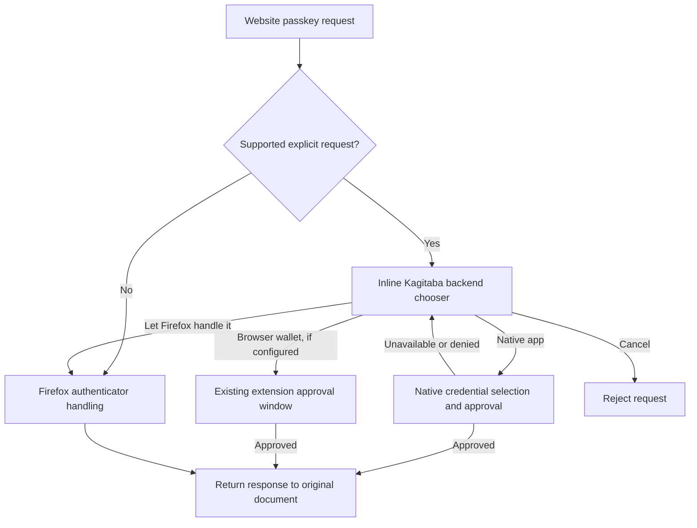

# Standalone Firefox extension

This is the agreed direction for Kagitaba's browser client. It describes the
intended implementation, not a claim that the features or hardware combinations
have already been validated.

## Product and workflows

The Firefox extension is a complete wallet client and software passkey provider.
It runs without the desktop application, native messaging, or a local service.
It provides password matching and explicit autofill, password saving/updating,
and website passkey registration and authentication. Website passkey private keys
remain encrypted in the wallet between uses. Firefox's own authenticator handling
remains available for physical security keys and other providers.

Use the application's friendly blue/aqua visual language, with clean, functional
screens and clear tasks: enrol this installation, connect a wallet, unlock, select
a credential, approve a request, save an entry, synchronize, and lock. Show the
requesting website and account in extension-owned approval UI. Never ask the user
to approve a secret operation in UI controlled by the requesting page.

## Participants and physical keys

Each extension installation/browser profile creates its own software participant
key pair. Different computers, browsers, and profiles are distinct participants.
An existing authorized client registers its public key and grants it access to
explicitly selected entries. Registration alone grants no entry access. Signing
authorization is separate and must also be enrolled for a writing client.

The participant's private material is encrypted in extension storage. A physical
YubiKey unlocks it using WebAuthn PRF, a domain-separated key derivation, and
authenticated encryption. This is separate from the native application's PIV
participant: a FIDO credential does not expose the PIV ECDH or signing slots.
Once unlocked, the software participant and software website passkeys are usable
in browser memory. This does not provide hardware-bound private operations for
the participant or for website passkeys.

Default to one unlock credential per installation, using a non-discoverable FIDO2
credential where the browser/key supports PRF. Store its credential ID, RP ID,
PRF input, derivation/version parameters, and encrypted envelope. Non-discoverable
credentials avoid consuming YubiKey discoverable-passkey slots. Probe actual PRF
support and fail explicitly if it is unavailable; a successful ordinary WebAuthn
assertion alone is not a decryption key. Do not silently substitute weaker unlock.

One primary YubiKey is sufficient. Additional keys may each wrap the same random
unlock secret, so any enrolled key can unlock the installation. Existing native
PIV backup grants do not automatically become browser unlock credentials. A lost
installation can instead be replaced by enrolling a new participant using a
remaining authorized wallet participant. Recoverability requires preserving the
encrypted wallet and the appropriate enrolment/unlock information.

Choose a stable, explicit RP ID and extension identity, with only the permissions
needed for their use. Browser participants remain independent even if the same
physical key unlocks them. Sharing participant private keys between installations
is possible in principle but is not the default workflow.

Include the PRF-encrypted participant package and its public credential ID,
PRF input, RP ID, installation context and format version in the participant's
enrolment request. The authorizing client preserves that package as signed
`participants/<key-id>/browser.json` alongside the public keys. No plaintext
private key or PRF output belongs in the repository. This permits explicit recovery
of the same participant from the encrypted replica with the original physical
key. Fresh installations still create separate participants by default. Recovery
does not restore freshness by itself: trusted root/checkpoint decisions remain
outside the synchronized wallet and must be re-established independently.

## Storage, trust, and synchronization

The extension keeps its own encrypted replica in persistent extension storage,
such as IndexedDB. It does not directly open the desktop wallet directory or use
ordinary browser cache as durable storage. The native client and extension can
synchronize through a common Git remote. Manual encrypted transfer also provides
an offline bootstrap/backup route; it must preserve authenticated history and
trust information rather than importing an unauthenticated working tree.

Reuse the existing record formats, recipient grants, CXF envelopes, and signed
Git history policy. Implement browser-compatible storage and transport; do not
invoke a native Git executable. Remote authentication is independent of wallet
decryption. Explain supported transports and protect stored remote credentials.
Persist trusted checkpoints and verify committed bytes and authorized signers
before exposing a new snapshot. Remote connection uses trust on first use: the
user selects an HTTPS URL and credentials; the extension discovers the genesis
signer, verifies the fetched history and pins that root and accepted head locally.
This does not independently authenticate the initial history or prove its freshness.
Manual transfer bootstrap retains explicit root/checkpoint input. Reject rollback,
unsigned history, unauthorized signers,
and divergence; do not automatically merge, force-push, or discard local edits.

Writes create complete matching revisions and grants, with fresh content keys.
Keep local changes durable before reporting success, and distinguish saved locally
from synchronized. New passkey registration must durably retain the credential
before returning success to the website. Uninstall/profile loss may destroy the
local replica: offer encrypted backup and make pending synchronization visible.

## Browser security boundaries

An injected page bridge adapts navigator.credentials.create/get to the extension
and retains native fallback. The bridge and all page messages are untrusted.
The privileged extension validates the actual sender tab/frame/document, origin,
secure context, RP ID relationship, challenge, supported algorithms, credential
allow/exclude lists, and request lifecycle. Do not trust a page-supplied origin.
Handle navigation, cancellation, timeouts, lock, and concurrent requests without
cross-delivering a credential or approval. Reject unsupported cross-origin/frame
cases explicitly until their full WebAuthn policy checks are implemented.

Implement supported WebAuthn responses correctly, including clientDataJSON,
authenticator data, signatures, credential IDs, and user handles. User presence
and user verification are different: never assert UV merely because the user
clicked approve. Enforce requested verification with an actual verification flow,
or reject/fall back. Imported CXF passkeys require a zero signature counter.
Preserved unsupported credentials must never become active by accident.

Password matching uses explicit origin/scope rules and respects supported import
match policies. Require an explicit fill/save choice, isolate frame destinations,
and do not send the whole vault or passkey private keys to content scripts. Lock
on timeout and user request; invalidate pending secret operations and clear
decrypted caches. Keep secrets out of logs, errors, fixtures, and persisted indexes.

Reuse Rust core/CXF through bundled WASM and keep application policy outside the
opaque layers. Cryptographic implementation remains Rust; browser APIs supply
randomness and WebAuthn. Bundle all executable assets, with a restrictive CSP and
minimal permissions. JavaScript/WASM memory cleanup is best-effort, not a claim of
complete erasure or protection from a compromised browser.

## Delivery and validation

Deliver a buildable, locally installable Firefox extension with operational setup,
enrolment, unlock, wallet browsing/editing, autofill/save, software passkey
registration/authentication, encrypted persistence, and verified synchronization.
Include the necessary native-client enrolment/transfer integration so an existing
wallet can actually authorize and grant access to the installation. Do not stop
at a UI mockup, isolated signing demo, or scaffold with production-path stubs.

Use synthetic fixtures and meaningful browser/integration tests for origin/RP
confusion, forged messages, wrong-key/tampered envelopes, lock races, persistence,
signature/trust failures, sync conflicts, and passkey registration/assertion.
Preserve existing workspace regression tests and portable WASM compatibility.
Document exact build/load/test commands and supported browser/key versions.
Physical-key and real-site checks that cannot be run must remain clearly marked
as pending; passing simulated tests is not physical-device validation. Marketplace
publication, signing submissions, and Git commits/pushes are separate actions.

## References

- [WebAuthn specification](https://www.w3.org/TR/webauthn-3/)
- [WebAuthn in extensions](https://developer.mozilla.org/en-US/docs/Mozilla/Add-ons/WebExtensions/Use_the_web_authn_api)
- [Yubico PRF guide](https://developers.yubico.com/WebAuthn/Concepts/PRF_Extension/Developers_Guide_to_PRF.html)
- [Discoverable and non-discoverable PRF support](https://docs.yubico.com/yesdk/users-manual/application-fido2/hmac-secret.html)
- [Bitwarden's extension provider architecture](https://contributing.bitwarden.com/architecture/deep-dives/passkeys/implementations/provider/browser-extension/)
- [Extension storage permissions](https://developer.mozilla.org/en-US/docs/Mozilla/Add-ons/WebExtensions/manifest.json/permissions#unlimited_storage)
- [CXF 1.0 with errata](https://fidoalliance.org/specs/cx/cxf-v1.0-ps-errata-20260309.html)

## Native gateway alternative

The standalone participant architecture above remains available. An explicit
connected mode uses the already enrolled Linux client through Firefox Native
Messaging and a private Unix socket. The browser is a request/fill frontend and
needs no participant keys, PRF enrollment or replica in this mode. Each password
release requires native entry selection and approval of the exact HTTPS origin.
The native worker verifies scope after decryption, and the extension binds fill
to the initiating top-level document. Lock, expiry, navigation and disconnect
cancel pending delivery. This does not attest browser origins against a hostile
same-user process or protect passwords from the receiving extension/page.

The bridge forwards bounded frames unchanged. Credential semantics belong to
the endpoints: basic-auth filling and ES256 WebAuthn create/get, with native
approval and fresh PIV PIN verification for passkeys. Registration persists a
signed encrypted entry before success. Unsupported WebAuthn requests fall back
to Firefox. A system CTAP authenticator and phone transport remain separate work.
Protocol, installation and current validation details live in the native and
Firefox AGENTS.md files. Reference: [Mozilla Native Messaging documentation](https://developer.mozilla.org/en-US/docs/Mozilla/Add-ons/WebExtensions/Native_messaging).

## Passkey chooser and backend roadmap (2026-10-20)

### Implemented request flow

The immediate priority is the native wallet workflow. Browser wallet storage,
enrollment and management remain a single-replica implementation. Multiple
browser repositories and linked phones below are goals, not implemented features.

Supported explicit create/get requests first show a small rectangular inline
Kagitaba chooser on the requesting page. It shows the verified origin, configured
backends, Firefox handoff and Cancel. Selecting a backend is routing only:
credential selection, unlocking, PIN/PRF and final approval stay in trusted
extension/native UI. A page-hosted overlay can be obscured or imitated by the
website, even with Shadow DOM; never put secrets or final authorization there.
No native request starts merely because a website requested a passkey.

Current buttons are Browser wallet (only when enrolled and connected), Native
app (after selecting Use native client in the toolbar UI), Let Firefox handle it,
and Cancel. Toolbar mode chooses a management screen; configured backends remain
available to passkey requests. The native preference is not live host discovery.
An unavailable/denied native request returns to the chooser with a fixed retry
message. The user can start/unlock the app and retry the same website request
before its timeout, choose Firefox, or cancel. No automatic app launch is added.
Conditional mediation and unsupported options continue to use Firefox directly.

The background binds selection and completion to tab, document token, origin and
request ID, rechecks the current document before dispatch and before releasing a
credential, and bounds request concurrency and lifetime. Lock, page abort,
navigation and tab closure cancel routing and pending native work. Late replies
cannot revive a finished request. Firefox handoff uses the original options and
signal and preserves Firefox's asynchronous rejection type. Native failures are
not automatically interpreted as permission to use another backend.

### Multi-backend goal (deferred)

The intended chooser is:

`[ last-used browser wallet | v ]  [ Native app ]  [ Let Firefox handle it ]`

Hide the browser-wallet control when none exist. With one, show its local display
name without a dropdown; with several, make the last-used wallet the main action
and list the others in the dropdown. Choosing a default does not authorize silent
signing. Keep repository URLs, usernames, credential counts and account names out
of page-hosted routing UI. Evaluate an extension-origin embedded surface before
displaying private wallet labels on websites.

There can eventually be multiple browser replicas, one native connection (whose
app can select among multiple repositories), and optionally several linked phones.
Each browser replica needs isolated accepted root/head checkpoints, remote auth,
storage, caches and pending mutations; selecting one must never retarget an
in-flight request. Migration from the existing singleton must preserve its
encrypted identity and accepted trust state. Participant/unlock sharing across
replicas is still a design decision. Native repository fan-out belongs to the
native app, not browser-side enumeration of local wallets. Phone pairing,
transport, approval and revocation are separate design/implementation work.

Standard phone QR authentication is FIDO CTAP hybrid transport: QR bootstrapping,
BLE proximity verification, authenticated encrypted transport and authenticator
messages. An extension can render the QR, but Firefox on Linux lacks the BLE APIs
needed to implement the transport alone. Put proximity/transport in a native
component and keep the request bound to its verified website origin. Do not remove
proximity checks to create an apparent JavaScript-only polyfill. A bespoke linked
Kagitaba-phone protocol would require its own pairing/threat model and would not
automatically interoperate with OS phone passkeys. Do not assume every phone
credential provider participates in the platform hybrid transport.

Sources checked 2026-10-20:

- [Mozilla Linux hybrid-transport tracking](https://bugzilla.mozilla.org/show_bug.cgi?id=1543674)
  (Windows/macOS can use OS support; the Linux feature remains open).
- [Mozilla Web Bluetooth tracking](https://bugzilla.mozilla.org/show_bug.cgi?id=674737).
- [FIDO CTAP 2.3, hybrid transport section 11.5](https://fidoalliance.org/specs/fido-v2.3-ps-20260226/fido-client-to-authenticator-protocol-v2.3-ps-20260226.html).
